# Emerald public graphics

This page is generated from the repository's verified `graphics/` tree. Japanese and Korean assets are listed before English and other official languages.

## Header

| Preview | File | Language | Size | SHA-256 |
| --- | --- | --- | --- | --- |
|  | [`graphics/header/nintendo-logo.png`](graphics/header/nintendo-logo.png) | Unspecified | 416x64 | `f07daf6e489d64b7...` |

## Pokemon

| Preview | File | Language | Size | SHA-256 |
| --- | --- | --- | --- | --- |
|  | [`graphics/pokemon/blastoise-back-bpe-j-rev0-retail.png`](graphics/pokemon/blastoise-back-bpe-j-rev0-retail.png) | Japanese | 128x128 | `7bb37807bac10be8...` |
|  | [`graphics/pokemon/blastoise-front-bpe-j-rev0-retail.png`](graphics/pokemon/blastoise-front-bpe-j-rev0-retail.png) | Japanese | 128x128 | `d42812517389bf5d...` |
| 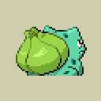 | [`graphics/pokemon/bulbasaur-back-bpe-j-rev0-retail.png`](graphics/pokemon/bulbasaur-back-bpe-j-rev0-retail.png) | Japanese | 128x128 | `a56ef8e9a9b690fc...` |
| 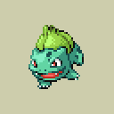 | [`graphics/pokemon/bulbasaur-front-bpe-j-rev0-retail.png`](graphics/pokemon/bulbasaur-front-bpe-j-rev0-retail.png) | Japanese | 128x128 | `8a325c6541282fa7...` |
| 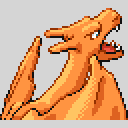 | [`graphics/pokemon/charizard-back-bpe-j-rev0-retail.png`](graphics/pokemon/charizard-back-bpe-j-rev0-retail.png) | Japanese | 128x128 | `3d0a42b79e5f9b53...` |
| 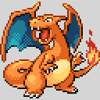 | [`graphics/pokemon/charizard-front-bpe-j-rev0-retail.png`](graphics/pokemon/charizard-front-bpe-j-rev0-retail.png) | Japanese | 128x128 | `797b28665827c19e...` |
| 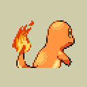 | [`graphics/pokemon/charmander-back-bpe-j-rev0-retail.png`](graphics/pokemon/charmander-back-bpe-j-rev0-retail.png) | Japanese | 128x128 | `0521ce266d4c527f...` |
| 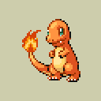 | [`graphics/pokemon/charmander-front-bpe-j-rev0-retail.png`](graphics/pokemon/charmander-front-bpe-j-rev0-retail.png) | Japanese | 128x128 | `c2521fd7f5d54944...` |
| 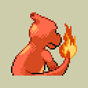 | [`graphics/pokemon/charmeleon-back-bpe-j-rev0-retail.png`](graphics/pokemon/charmeleon-back-bpe-j-rev0-retail.png) | Japanese | 128x128 | `930bd0b4b2900d41...` |
| 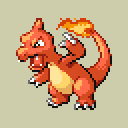 | [`graphics/pokemon/charmeleon-front-bpe-j-rev0-retail.png`](graphics/pokemon/charmeleon-front-bpe-j-rev0-retail.png) | Japanese | 128x128 | `81a6fbf60b8bfd50...` |
|  | [`graphics/pokemon/ivysaur-back-bpe-j-rev0-retail.png`](graphics/pokemon/ivysaur-back-bpe-j-rev0-retail.png) | Japanese | 128x128 | `57f839867dfb4f04...` |
| 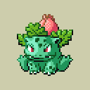 | [`graphics/pokemon/ivysaur-front-bpe-j-rev0-retail.png`](graphics/pokemon/ivysaur-front-bpe-j-rev0-retail.png) | Japanese | 128x128 | `317ca13389c4a268...` |
|  | [`graphics/pokemon/pikachu-back-bpe-j-rev0-retail.png`](graphics/pokemon/pikachu-back-bpe-j-rev0-retail.png) | Japanese | 128x128 | `d1472dd2f4862fe9...` |
|  | [`graphics/pokemon/pikachu-front-bpe-j-rev0-retail.png`](graphics/pokemon/pikachu-front-bpe-j-rev0-retail.png) | Japanese | 128x128 | `0be25ad9c369dfb5...` |
|  | [`graphics/pokemon/rayquaza-back-bpe-j-rev0-retail.png`](graphics/pokemon/rayquaza-back-bpe-j-rev0-retail.png) | Japanese | 128x128 | `0fd8617aedfa2e1e...` |
|  | [`graphics/pokemon/rayquaza-front-bpe-j-rev0-retail.png`](graphics/pokemon/rayquaza-front-bpe-j-rev0-retail.png) | Japanese | 128x128 | `6014868be44b7e15...` |
| 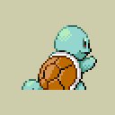 | [`graphics/pokemon/squirtle-back-bpe-j-rev0-retail.png`](graphics/pokemon/squirtle-back-bpe-j-rev0-retail.png) | Japanese | 128x128 | `c80710c9b72dc8c6...` |
|  | [`graphics/pokemon/squirtle-front-bpe-j-rev0-retail.png`](graphics/pokemon/squirtle-front-bpe-j-rev0-retail.png) | Japanese | 128x128 | `867c957520288232...` |
| 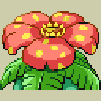 | [`graphics/pokemon/venusaur-back-bpe-j-rev0-retail.png`](graphics/pokemon/venusaur-back-bpe-j-rev0-retail.png) | Japanese | 128x128 | `8467656ef54308b2...` |
| 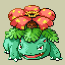 | [`graphics/pokemon/venusaur-front-bpe-j-rev0-retail.png`](graphics/pokemon/venusaur-front-bpe-j-rev0-retail.png) | Japanese | 128x128 | `9c6f9fdb302031aa...` |
|  | [`graphics/pokemon/wartortle-back-bpe-j-rev0-retail.png`](graphics/pokemon/wartortle-back-bpe-j-rev0-retail.png) | Japanese | 128x128 | `5d2150f21ea37fd7...` |
|  | [`graphics/pokemon/wartortle-front-bpe-j-rev0-retail.png`](graphics/pokemon/wartortle-front-bpe-j-rev0-retail.png) | Japanese | 128x128 | `d082be86e7d6b935...` |
| 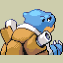 | [`graphics/pokemon/blastoise-back-bpe-e-rev0-retail.png`](graphics/pokemon/blastoise-back-bpe-e-rev0-retail.png) | English | 128x128 | `7bb37807bac10be8...` |
|  | [`graphics/pokemon/blastoise-front-bpe-e-rev0-retail.png`](graphics/pokemon/blastoise-front-bpe-e-rev0-retail.png) | English | 128x128 | `d42812517389bf5d...` |
|  | [`graphics/pokemon/bulbasaur-back-bpe-e-rev0-retail.png`](graphics/pokemon/bulbasaur-back-bpe-e-rev0-retail.png) | English | 128x128 | `a56ef8e9a9b690fc...` |
|  | [`graphics/pokemon/bulbasaur-front-bpe-e-rev0-retail.png`](graphics/pokemon/bulbasaur-front-bpe-e-rev0-retail.png) | English | 128x128 | `8a325c6541282fa7...` |
|  | [`graphics/pokemon/charizard-back-bpe-e-rev0-retail.png`](graphics/pokemon/charizard-back-bpe-e-rev0-retail.png) | English | 128x128 | `3d0a42b79e5f9b53...` |
|  | [`graphics/pokemon/charizard-front-bpe-e-rev0-retail.png`](graphics/pokemon/charizard-front-bpe-e-rev0-retail.png) | English | 128x128 | `797b28665827c19e...` |
|  | [`graphics/pokemon/charmander-back-bpe-e-rev0-retail.png`](graphics/pokemon/charmander-back-bpe-e-rev0-retail.png) | English | 128x128 | `0521ce266d4c527f...` |
|  | [`graphics/pokemon/charmander-front-bpe-e-rev0-retail.png`](graphics/pokemon/charmander-front-bpe-e-rev0-retail.png) | English | 128x128 | `c2521fd7f5d54944...` |
|  | [`graphics/pokemon/charmeleon-back-bpe-e-rev0-retail.png`](graphics/pokemon/charmeleon-back-bpe-e-rev0-retail.png) | English | 128x128 | `930bd0b4b2900d41...` |
|  | [`graphics/pokemon/charmeleon-front-bpe-e-rev0-retail.png`](graphics/pokemon/charmeleon-front-bpe-e-rev0-retail.png) | English | 128x128 | `81a6fbf60b8bfd50...` |
|  | [`graphics/pokemon/ivysaur-back-bpe-e-rev0-retail.png`](graphics/pokemon/ivysaur-back-bpe-e-rev0-retail.png) | English | 128x128 | `57f839867dfb4f04...` |
|  | [`graphics/pokemon/ivysaur-front-bpe-e-rev0-retail.png`](graphics/pokemon/ivysaur-front-bpe-e-rev0-retail.png) | English | 128x128 | `317ca13389c4a268...` |
|  | [`graphics/pokemon/pikachu-back-bpe-e-rev0-retail.png`](graphics/pokemon/pikachu-back-bpe-e-rev0-retail.png) | English | 128x128 | `d1472dd2f4862fe9...` |
|  | [`graphics/pokemon/pikachu-front-bpe-e-rev0-retail.png`](graphics/pokemon/pikachu-front-bpe-e-rev0-retail.png) | English | 128x128 | `0be25ad9c369dfb5...` |
|  | [`graphics/pokemon/rayquaza-back-bpe-e-rev0-retail.png`](graphics/pokemon/rayquaza-back-bpe-e-rev0-retail.png) | English | 128x128 | `0fd8617aedfa2e1e...` |
|  | [`graphics/pokemon/rayquaza-front-bpe-e-rev0-retail.png`](graphics/pokemon/rayquaza-front-bpe-e-rev0-retail.png) | English | 128x128 | `6014868be44b7e15...` |
|  | [`graphics/pokemon/squirtle-back-bpe-e-rev0-retail.png`](graphics/pokemon/squirtle-back-bpe-e-rev0-retail.png) | English | 128x128 | `c80710c9b72dc8c6...` |
|  | [`graphics/pokemon/squirtle-front-bpe-e-rev0-retail.png`](graphics/pokemon/squirtle-front-bpe-e-rev0-retail.png) | English | 128x128 | `867c957520288232...` |
|  | [`graphics/pokemon/venusaur-back-bpe-e-rev0-retail.png`](graphics/pokemon/venusaur-back-bpe-e-rev0-retail.png) | English | 128x128 | `8467656ef54308b2...` |
|  | [`graphics/pokemon/venusaur-front-bpe-e-rev0-retail.png`](graphics/pokemon/venusaur-front-bpe-e-rev0-retail.png) | English | 128x128 | `9c6f9fdb302031aa...` |
|  | [`graphics/pokemon/wartortle-back-bpe-e-rev0-retail.png`](graphics/pokemon/wartortle-back-bpe-e-rev0-retail.png) | English | 128x128 | `5d2150f21ea37fd7...` |
|  | [`graphics/pokemon/wartortle-front-bpe-e-rev0-retail.png`](graphics/pokemon/wartortle-front-bpe-e-rev0-retail.png) | English | 128x128 | `d082be86e7d6b935...` |
|  | [`graphics/pokemon/blastoise-back-bpe-d-rev0-retail.png`](graphics/pokemon/blastoise-back-bpe-d-rev0-retail.png) | German | 128x128 | `7bb37807bac10be8...` |
|  | [`graphics/pokemon/blastoise-front-bpe-d-rev0-retail.png`](graphics/pokemon/blastoise-front-bpe-d-rev0-retail.png) | German | 128x128 | `d42812517389bf5d...` |
|  | [`graphics/pokemon/bulbasaur-back-bpe-d-rev0-retail.png`](graphics/pokemon/bulbasaur-back-bpe-d-rev0-retail.png) | German | 128x128 | `a56ef8e9a9b690fc...` |
|  | [`graphics/pokemon/bulbasaur-front-bpe-d-rev0-retail.png`](graphics/pokemon/bulbasaur-front-bpe-d-rev0-retail.png) | German | 128x128 | `8a325c6541282fa7...` |
|  | [`graphics/pokemon/charizard-back-bpe-d-rev0-retail.png`](graphics/pokemon/charizard-back-bpe-d-rev0-retail.png) | German | 128x128 | `3d0a42b79e5f9b53...` |
|  | [`graphics/pokemon/charizard-front-bpe-d-rev0-retail.png`](graphics/pokemon/charizard-front-bpe-d-rev0-retail.png) | German | 128x128 | `797b28665827c19e...` |
|  | [`graphics/pokemon/charmander-back-bpe-d-rev0-retail.png`](graphics/pokemon/charmander-back-bpe-d-rev0-retail.png) | German | 128x128 | `0521ce266d4c527f...` |
|  | [`graphics/pokemon/charmander-front-bpe-d-rev0-retail.png`](graphics/pokemon/charmander-front-bpe-d-rev0-retail.png) | German | 128x128 | `c2521fd7f5d54944...` |
|  | [`graphics/pokemon/charmeleon-back-bpe-d-rev0-retail.png`](graphics/pokemon/charmeleon-back-bpe-d-rev0-retail.png) | German | 128x128 | `930bd0b4b2900d41...` |
|  | [`graphics/pokemon/charmeleon-front-bpe-d-rev0-retail.png`](graphics/pokemon/charmeleon-front-bpe-d-rev0-retail.png) | German | 128x128 | `81a6fbf60b8bfd50...` |
| 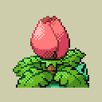 | [`graphics/pokemon/ivysaur-back-bpe-d-rev0-retail.png`](graphics/pokemon/ivysaur-back-bpe-d-rev0-retail.png) | German | 128x128 | `57f839867dfb4f04...` |
|  | [`graphics/pokemon/ivysaur-front-bpe-d-rev0-retail.png`](graphics/pokemon/ivysaur-front-bpe-d-rev0-retail.png) | German | 128x128 | `317ca13389c4a268...` |
|  | [`graphics/pokemon/pikachu-back-bpe-d-rev0-retail.png`](graphics/pokemon/pikachu-back-bpe-d-rev0-retail.png) | German | 128x128 | `d1472dd2f4862fe9...` |
|  | [`graphics/pokemon/pikachu-front-bpe-d-rev0-retail.png`](graphics/pokemon/pikachu-front-bpe-d-rev0-retail.png) | German | 128x128 | `0be25ad9c369dfb5...` |
|  | [`graphics/pokemon/rayquaza-back-bpe-d-rev0-retail.png`](graphics/pokemon/rayquaza-back-bpe-d-rev0-retail.png) | German | 128x128 | `0fd8617aedfa2e1e...` |
| 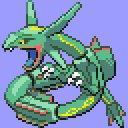 | [`graphics/pokemon/rayquaza-front-bpe-d-rev0-retail.png`](graphics/pokemon/rayquaza-front-bpe-d-rev0-retail.png) | German | 128x128 | `6014868be44b7e15...` |
|  | [`graphics/pokemon/squirtle-back-bpe-d-rev0-retail.png`](graphics/pokemon/squirtle-back-bpe-d-rev0-retail.png) | German | 128x128 | `c80710c9b72dc8c6...` |
|  | [`graphics/pokemon/squirtle-front-bpe-d-rev0-retail.png`](graphics/pokemon/squirtle-front-bpe-d-rev0-retail.png) | German | 128x128 | `867c957520288232...` |
|  | [`graphics/pokemon/venusaur-back-bpe-d-rev0-retail.png`](graphics/pokemon/venusaur-back-bpe-d-rev0-retail.png) | German | 128x128 | `8467656ef54308b2...` |
|  | [`graphics/pokemon/venusaur-front-bpe-d-rev0-retail.png`](graphics/pokemon/venusaur-front-bpe-d-rev0-retail.png) | German | 128x128 | `9c6f9fdb302031aa...` |
|  | [`graphics/pokemon/wartortle-back-bpe-d-rev0-retail.png`](graphics/pokemon/wartortle-back-bpe-d-rev0-retail.png) | German | 128x128 | `5d2150f21ea37fd7...` |
|  | [`graphics/pokemon/wartortle-front-bpe-d-rev0-retail.png`](graphics/pokemon/wartortle-front-bpe-d-rev0-retail.png) | German | 128x128 | `d082be86e7d6b935...` |
|  | [`graphics/pokemon/blastoise-back-bpe-f-rev0-retail.png`](graphics/pokemon/blastoise-back-bpe-f-rev0-retail.png) | French | 128x128 | `7bb37807bac10be8...` |
|  | [`graphics/pokemon/blastoise-front-bpe-f-rev0-retail.png`](graphics/pokemon/blastoise-front-bpe-f-rev0-retail.png) | French | 128x128 | `d42812517389bf5d...` |
|  | [`graphics/pokemon/bulbasaur-back-bpe-f-rev0-retail.png`](graphics/pokemon/bulbasaur-back-bpe-f-rev0-retail.png) | French | 128x128 | `a56ef8e9a9b690fc...` |
|  | [`graphics/pokemon/bulbasaur-front-bpe-f-rev0-retail.png`](graphics/pokemon/bulbasaur-front-bpe-f-rev0-retail.png) | French | 128x128 | `8a325c6541282fa7...` |
|  | [`graphics/pokemon/charizard-back-bpe-f-rev0-retail.png`](graphics/pokemon/charizard-back-bpe-f-rev0-retail.png) | French | 128x128 | `3d0a42b79e5f9b53...` |
|  | [`graphics/pokemon/charizard-front-bpe-f-rev0-retail.png`](graphics/pokemon/charizard-front-bpe-f-rev0-retail.png) | French | 128x128 | `797b28665827c19e...` |
|  | [`graphics/pokemon/charmander-back-bpe-f-rev0-retail.png`](graphics/pokemon/charmander-back-bpe-f-rev0-retail.png) | French | 128x128 | `0521ce266d4c527f...` |
|  | [`graphics/pokemon/charmander-front-bpe-f-rev0-retail.png`](graphics/pokemon/charmander-front-bpe-f-rev0-retail.png) | French | 128x128 | `c2521fd7f5d54944...` |
|  | [`graphics/pokemon/charmeleon-back-bpe-f-rev0-retail.png`](graphics/pokemon/charmeleon-back-bpe-f-rev0-retail.png) | French | 128x128 | `930bd0b4b2900d41...` |
|  | [`graphics/pokemon/charmeleon-front-bpe-f-rev0-retail.png`](graphics/pokemon/charmeleon-front-bpe-f-rev0-retail.png) | French | 128x128 | `81a6fbf60b8bfd50...` |
|  | [`graphics/pokemon/ivysaur-back-bpe-f-rev0-retail.png`](graphics/pokemon/ivysaur-back-bpe-f-rev0-retail.png) | French | 128x128 | `57f839867dfb4f04...` |
|  | [`graphics/pokemon/ivysaur-front-bpe-f-rev0-retail.png`](graphics/pokemon/ivysaur-front-bpe-f-rev0-retail.png) | French | 128x128 | `317ca13389c4a268...` |
|  | [`graphics/pokemon/pikachu-back-bpe-f-rev0-retail.png`](graphics/pokemon/pikachu-back-bpe-f-rev0-retail.png) | French | 128x128 | `d1472dd2f4862fe9...` |
|  | [`graphics/pokemon/pikachu-front-bpe-f-rev0-retail.png`](graphics/pokemon/pikachu-front-bpe-f-rev0-retail.png) | French | 128x128 | `0be25ad9c369dfb5...` |
|  | [`graphics/pokemon/rayquaza-back-bpe-f-rev0-retail.png`](graphics/pokemon/rayquaza-back-bpe-f-rev0-retail.png) | French | 128x128 | `0fd8617aedfa2e1e...` |
|  | [`graphics/pokemon/rayquaza-front-bpe-f-rev0-retail.png`](graphics/pokemon/rayquaza-front-bpe-f-rev0-retail.png) | French | 128x128 | `6014868be44b7e15...` |
|  | [`graphics/pokemon/squirtle-back-bpe-f-rev0-retail.png`](graphics/pokemon/squirtle-back-bpe-f-rev0-retail.png) | French | 128x128 | `c80710c9b72dc8c6...` |
|  | [`graphics/pokemon/squirtle-front-bpe-f-rev0-retail.png`](graphics/pokemon/squirtle-front-bpe-f-rev0-retail.png) | French | 128x128 | `867c957520288232...` |
|  | [`graphics/pokemon/venusaur-back-bpe-f-rev0-retail.png`](graphics/pokemon/venusaur-back-bpe-f-rev0-retail.png) | French | 128x128 | `8467656ef54308b2...` |
|  | [`graphics/pokemon/venusaur-front-bpe-f-rev0-retail.png`](graphics/pokemon/venusaur-front-bpe-f-rev0-retail.png) | French | 128x128 | `9c6f9fdb302031aa...` |
|  | [`graphics/pokemon/wartortle-back-bpe-f-rev0-retail.png`](graphics/pokemon/wartortle-back-bpe-f-rev0-retail.png) | French | 128x128 | `5d2150f21ea37fd7...` |
|  | [`graphics/pokemon/wartortle-front-bpe-f-rev0-retail.png`](graphics/pokemon/wartortle-front-bpe-f-rev0-retail.png) | French | 128x128 | `d082be86e7d6b935...` |
|  | [`graphics/pokemon/blastoise-back-bpe-i-rev0-retail.png`](graphics/pokemon/blastoise-back-bpe-i-rev0-retail.png) | Italian | 128x128 | `7bb37807bac10be8...` |
|  | [`graphics/pokemon/blastoise-front-bpe-i-rev0-retail.png`](graphics/pokemon/blastoise-front-bpe-i-rev0-retail.png) | Italian | 128x128 | `d42812517389bf5d...` |
|  | [`graphics/pokemon/bulbasaur-back-bpe-i-rev0-retail.png`](graphics/pokemon/bulbasaur-back-bpe-i-rev0-retail.png) | Italian | 128x128 | `a56ef8e9a9b690fc...` |
|  | [`graphics/pokemon/bulbasaur-front-bpe-i-rev0-retail.png`](graphics/pokemon/bulbasaur-front-bpe-i-rev0-retail.png) | Italian | 128x128 | `8a325c6541282fa7...` |
|  | [`graphics/pokemon/charizard-back-bpe-i-rev0-retail.png`](graphics/pokemon/charizard-back-bpe-i-rev0-retail.png) | Italian | 128x128 | `3d0a42b79e5f9b53...` |
|  | [`graphics/pokemon/charizard-front-bpe-i-rev0-retail.png`](graphics/pokemon/charizard-front-bpe-i-rev0-retail.png) | Italian | 128x128 | `797b28665827c19e...` |
|  | [`graphics/pokemon/charmander-back-bpe-i-rev0-retail.png`](graphics/pokemon/charmander-back-bpe-i-rev0-retail.png) | Italian | 128x128 | `0521ce266d4c527f...` |
|  | [`graphics/pokemon/charmander-front-bpe-i-rev0-retail.png`](graphics/pokemon/charmander-front-bpe-i-rev0-retail.png) | Italian | 128x128 | `c2521fd7f5d54944...` |
|  | [`graphics/pokemon/charmeleon-back-bpe-i-rev0-retail.png`](graphics/pokemon/charmeleon-back-bpe-i-rev0-retail.png) | Italian | 128x128 | `930bd0b4b2900d41...` |
|  | [`graphics/pokemon/charmeleon-front-bpe-i-rev0-retail.png`](graphics/pokemon/charmeleon-front-bpe-i-rev0-retail.png) | Italian | 128x128 | `81a6fbf60b8bfd50...` |
|  | [`graphics/pokemon/ivysaur-back-bpe-i-rev0-retail.png`](graphics/pokemon/ivysaur-back-bpe-i-rev0-retail.png) | Italian | 128x128 | `57f839867dfb4f04...` |
|  | [`graphics/pokemon/ivysaur-front-bpe-i-rev0-retail.png`](graphics/pokemon/ivysaur-front-bpe-i-rev0-retail.png) | Italian | 128x128 | `317ca13389c4a268...` |
|  | [`graphics/pokemon/pikachu-back-bpe-i-rev0-retail.png`](graphics/pokemon/pikachu-back-bpe-i-rev0-retail.png) | Italian | 128x128 | `d1472dd2f4862fe9...` |
|  | [`graphics/pokemon/pikachu-front-bpe-i-rev0-retail.png`](graphics/pokemon/pikachu-front-bpe-i-rev0-retail.png) | Italian | 128x128 | `0be25ad9c369dfb5...` |
|  | [`graphics/pokemon/rayquaza-back-bpe-i-rev0-retail.png`](graphics/pokemon/rayquaza-back-bpe-i-rev0-retail.png) | Italian | 128x128 | `0fd8617aedfa2e1e...` |
|  | [`graphics/pokemon/rayquaza-front-bpe-i-rev0-retail.png`](graphics/pokemon/rayquaza-front-bpe-i-rev0-retail.png) | Italian | 128x128 | `6014868be44b7e15...` |
|  | [`graphics/pokemon/squirtle-back-bpe-i-rev0-retail.png`](graphics/pokemon/squirtle-back-bpe-i-rev0-retail.png) | Italian | 128x128 | `c80710c9b72dc8c6...` |
|  | [`graphics/pokemon/squirtle-front-bpe-i-rev0-retail.png`](graphics/pokemon/squirtle-front-bpe-i-rev0-retail.png) | Italian | 128x128 | `867c957520288232...` |
|  | [`graphics/pokemon/venusaur-back-bpe-i-rev0-retail.png`](graphics/pokemon/venusaur-back-bpe-i-rev0-retail.png) | Italian | 128x128 | `8467656ef54308b2...` |
|  | [`graphics/pokemon/venusaur-front-bpe-i-rev0-retail.png`](graphics/pokemon/venusaur-front-bpe-i-rev0-retail.png) | Italian | 128x128 | `9c6f9fdb302031aa...` |
|  | [`graphics/pokemon/wartortle-back-bpe-i-rev0-retail.png`](graphics/pokemon/wartortle-back-bpe-i-rev0-retail.png) | Italian | 128x128 | `5d2150f21ea37fd7...` |
|  | [`graphics/pokemon/wartortle-front-bpe-i-rev0-retail.png`](graphics/pokemon/wartortle-front-bpe-i-rev0-retail.png) | Italian | 128x128 | `d082be86e7d6b935...` |
|  | [`graphics/pokemon/blastoise-back-bpe-s-rev0-retail.png`](graphics/pokemon/blastoise-back-bpe-s-rev0-retail.png) | Spanish | 128x128 | `7bb37807bac10be8...` |
|  | [`graphics/pokemon/blastoise-front-bpe-s-rev0-retail.png`](graphics/pokemon/blastoise-front-bpe-s-rev0-retail.png) | Spanish | 128x128 | `d42812517389bf5d...` |
|  | [`graphics/pokemon/bulbasaur-back-bpe-s-rev0-retail.png`](graphics/pokemon/bulbasaur-back-bpe-s-rev0-retail.png) | Spanish | 128x128 | `a56ef8e9a9b690fc...` |
|  | [`graphics/pokemon/bulbasaur-front-bpe-s-rev0-retail.png`](graphics/pokemon/bulbasaur-front-bpe-s-rev0-retail.png) | Spanish | 128x128 | `8a325c6541282fa7...` |
|  | [`graphics/pokemon/charizard-back-bpe-s-rev0-retail.png`](graphics/pokemon/charizard-back-bpe-s-rev0-retail.png) | Spanish | 128x128 | `3d0a42b79e5f9b53...` |
|  | [`graphics/pokemon/charizard-front-bpe-s-rev0-retail.png`](graphics/pokemon/charizard-front-bpe-s-rev0-retail.png) | Spanish | 128x128 | `797b28665827c19e...` |
|  | [`graphics/pokemon/charmander-back-bpe-s-rev0-retail.png`](graphics/pokemon/charmander-back-bpe-s-rev0-retail.png) | Spanish | 128x128 | `0521ce266d4c527f...` |
|  | [`graphics/pokemon/charmander-front-bpe-s-rev0-retail.png`](graphics/pokemon/charmander-front-bpe-s-rev0-retail.png) | Spanish | 128x128 | `c2521fd7f5d54944...` |
|  | [`graphics/pokemon/charmeleon-back-bpe-s-rev0-retail.png`](graphics/pokemon/charmeleon-back-bpe-s-rev0-retail.png) | Spanish | 128x128 | `930bd0b4b2900d41...` |
|  | [`graphics/pokemon/charmeleon-front-bpe-s-rev0-retail.png`](graphics/pokemon/charmeleon-front-bpe-s-rev0-retail.png) | Spanish | 128x128 | `81a6fbf60b8bfd50...` |
|  | [`graphics/pokemon/ivysaur-back-bpe-s-rev0-retail.png`](graphics/pokemon/ivysaur-back-bpe-s-rev0-retail.png) | Spanish | 128x128 | `57f839867dfb4f04...` |
|  | [`graphics/pokemon/ivysaur-front-bpe-s-rev0-retail.png`](graphics/pokemon/ivysaur-front-bpe-s-rev0-retail.png) | Spanish | 128x128 | `317ca13389c4a268...` |
|  | [`graphics/pokemon/pikachu-back-bpe-s-rev0-retail.png`](graphics/pokemon/pikachu-back-bpe-s-rev0-retail.png) | Spanish | 128x128 | `d1472dd2f4862fe9...` |
|  | [`graphics/pokemon/pikachu-front-bpe-s-rev0-retail.png`](graphics/pokemon/pikachu-front-bpe-s-rev0-retail.png) | Spanish | 128x128 | `0be25ad9c369dfb5...` |
| 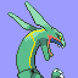 | [`graphics/pokemon/rayquaza-back-bpe-s-rev0-retail.png`](graphics/pokemon/rayquaza-back-bpe-s-rev0-retail.png) | Spanish | 128x128 | `0fd8617aedfa2e1e...` |
|  | [`graphics/pokemon/rayquaza-front-bpe-s-rev0-retail.png`](graphics/pokemon/rayquaza-front-bpe-s-rev0-retail.png) | Spanish | 128x128 | `6014868be44b7e15...` |
|  | [`graphics/pokemon/squirtle-back-bpe-s-rev0-retail.png`](graphics/pokemon/squirtle-back-bpe-s-rev0-retail.png) | Spanish | 128x128 | `c80710c9b72dc8c6...` |
|  | [`graphics/pokemon/squirtle-front-bpe-s-rev0-retail.png`](graphics/pokemon/squirtle-front-bpe-s-rev0-retail.png) | Spanish | 128x128 | `867c957520288232...` |
|  | [`graphics/pokemon/venusaur-back-bpe-s-rev0-retail.png`](graphics/pokemon/venusaur-back-bpe-s-rev0-retail.png) | Spanish | 128x128 | `8467656ef54308b2...` |
|  | [`graphics/pokemon/venusaur-front-bpe-s-rev0-retail.png`](graphics/pokemon/venusaur-front-bpe-s-rev0-retail.png) | Spanish | 128x128 | `9c6f9fdb302031aa...` |
|  | [`graphics/pokemon/wartortle-back-bpe-s-rev0-retail.png`](graphics/pokemon/wartortle-back-bpe-s-rev0-retail.png) | Spanish | 128x128 | `5d2150f21ea37fd7...` |
|  | [`graphics/pokemon/wartortle-front-bpe-s-rev0-retail.png`](graphics/pokemon/wartortle-front-bpe-s-rev0-retail.png) | Spanish | 128x128 | `d082be86e7d6b935...` |

| Palette | Language | Colors | SHA-256 |
| --- | --- | --- | --- |
| [`graphics/pokemon/blastoise-bpe-j-rev0-retail.pal`](graphics/pokemon/blastoise-bpe-j-rev0-retail.pal) | Japanese | 16 | `82620e8a8070e819...` |
| [`graphics/pokemon/bulbasaur-bpe-j-rev0-retail.pal`](graphics/pokemon/bulbasaur-bpe-j-rev0-retail.pal) | Japanese | 16 | `bb3a45b87ac47a26...` |
| [`graphics/pokemon/charizard-bpe-j-rev0-retail.pal`](graphics/pokemon/charizard-bpe-j-rev0-retail.pal) | Japanese | 16 | `7be8d061c501217a...` |
| [`graphics/pokemon/charmander-bpe-j-rev0-retail.pal`](graphics/pokemon/charmander-bpe-j-rev0-retail.pal) | Japanese | 16 | `8e0275de21f38209...` |
| [`graphics/pokemon/charmeleon-bpe-j-rev0-retail.pal`](graphics/pokemon/charmeleon-bpe-j-rev0-retail.pal) | Japanese | 16 | `fda56b497c54ea3e...` |
| [`graphics/pokemon/ivysaur-bpe-j-rev0-retail.pal`](graphics/pokemon/ivysaur-bpe-j-rev0-retail.pal) | Japanese | 16 | `b33f61ed2e335591...` |
| [`graphics/pokemon/pikachu-bpe-j-rev0-retail.pal`](graphics/pokemon/pikachu-bpe-j-rev0-retail.pal) | Japanese | 16 | `066a8707fdfbf027...` |
| [`graphics/pokemon/rayquaza-bpe-j-rev0-retail.pal`](graphics/pokemon/rayquaza-bpe-j-rev0-retail.pal) | Japanese | 16 | `8c8295d3b822749a...` |
| [`graphics/pokemon/squirtle-bpe-j-rev0-retail.pal`](graphics/pokemon/squirtle-bpe-j-rev0-retail.pal) | Japanese | 16 | `90702f2e5e66ce90...` |
| [`graphics/pokemon/venusaur-bpe-j-rev0-retail.pal`](graphics/pokemon/venusaur-bpe-j-rev0-retail.pal) | Japanese | 16 | `11606f5afc78f891...` |
| [`graphics/pokemon/wartortle-bpe-j-rev0-retail.pal`](graphics/pokemon/wartortle-bpe-j-rev0-retail.pal) | Japanese | 16 | `a787b5d4ede926c7...` |
| [`graphics/pokemon/blastoise-bpe-e-rev0-retail.pal`](graphics/pokemon/blastoise-bpe-e-rev0-retail.pal) | English | 16 | `82620e8a8070e819...` |
| [`graphics/pokemon/bulbasaur-bpe-e-rev0-retail.pal`](graphics/pokemon/bulbasaur-bpe-e-rev0-retail.pal) | English | 16 | `bb3a45b87ac47a26...` |
| [`graphics/pokemon/charizard-bpe-e-rev0-retail.pal`](graphics/pokemon/charizard-bpe-e-rev0-retail.pal) | English | 16 | `7be8d061c501217a...` |
| [`graphics/pokemon/charmander-bpe-e-rev0-retail.pal`](graphics/pokemon/charmander-bpe-e-rev0-retail.pal) | English | 16 | `8e0275de21f38209...` |
| [`graphics/pokemon/charmeleon-bpe-e-rev0-retail.pal`](graphics/pokemon/charmeleon-bpe-e-rev0-retail.pal) | English | 16 | `fda56b497c54ea3e...` |
| [`graphics/pokemon/ivysaur-bpe-e-rev0-retail.pal`](graphics/pokemon/ivysaur-bpe-e-rev0-retail.pal) | English | 16 | `b33f61ed2e335591...` |
| [`graphics/pokemon/pikachu-bpe-e-rev0-retail.pal`](graphics/pokemon/pikachu-bpe-e-rev0-retail.pal) | English | 16 | `066a8707fdfbf027...` |
| [`graphics/pokemon/rayquaza-bpe-e-rev0-retail.pal`](graphics/pokemon/rayquaza-bpe-e-rev0-retail.pal) | English | 16 | `8c8295d3b822749a...` |
| [`graphics/pokemon/squirtle-bpe-e-rev0-retail.pal`](graphics/pokemon/squirtle-bpe-e-rev0-retail.pal) | English | 16 | `90702f2e5e66ce90...` |
| [`graphics/pokemon/venusaur-bpe-e-rev0-retail.pal`](graphics/pokemon/venusaur-bpe-e-rev0-retail.pal) | English | 16 | `11606f5afc78f891...` |
| [`graphics/pokemon/wartortle-bpe-e-rev0-retail.pal`](graphics/pokemon/wartortle-bpe-e-rev0-retail.pal) | English | 16 | `a787b5d4ede926c7...` |
| [`graphics/pokemon/blastoise-bpe-d-rev0-retail.pal`](graphics/pokemon/blastoise-bpe-d-rev0-retail.pal) | German | 16 | `82620e8a8070e819...` |
| [`graphics/pokemon/bulbasaur-bpe-d-rev0-retail.pal`](graphics/pokemon/bulbasaur-bpe-d-rev0-retail.pal) | German | 16 | `bb3a45b87ac47a26...` |
| [`graphics/pokemon/charizard-bpe-d-rev0-retail.pal`](graphics/pokemon/charizard-bpe-d-rev0-retail.pal) | German | 16 | `7be8d061c501217a...` |
| [`graphics/pokemon/charmander-bpe-d-rev0-retail.pal`](graphics/pokemon/charmander-bpe-d-rev0-retail.pal) | German | 16 | `8e0275de21f38209...` |
| [`graphics/pokemon/charmeleon-bpe-d-rev0-retail.pal`](graphics/pokemon/charmeleon-bpe-d-rev0-retail.pal) | German | 16 | `fda56b497c54ea3e...` |
| [`graphics/pokemon/ivysaur-bpe-d-rev0-retail.pal`](graphics/pokemon/ivysaur-bpe-d-rev0-retail.pal) | German | 16 | `b33f61ed2e335591...` |
| [`graphics/pokemon/pikachu-bpe-d-rev0-retail.pal`](graphics/pokemon/pikachu-bpe-d-rev0-retail.pal) | German | 16 | `066a8707fdfbf027...` |
| [`graphics/pokemon/rayquaza-bpe-d-rev0-retail.pal`](graphics/pokemon/rayquaza-bpe-d-rev0-retail.pal) | German | 16 | `8c8295d3b822749a...` |
| [`graphics/pokemon/squirtle-bpe-d-rev0-retail.pal`](graphics/pokemon/squirtle-bpe-d-rev0-retail.pal) | German | 16 | `90702f2e5e66ce90...` |
| [`graphics/pokemon/venusaur-bpe-d-rev0-retail.pal`](graphics/pokemon/venusaur-bpe-d-rev0-retail.pal) | German | 16 | `11606f5afc78f891...` |
| [`graphics/pokemon/wartortle-bpe-d-rev0-retail.pal`](graphics/pokemon/wartortle-bpe-d-rev0-retail.pal) | German | 16 | `a787b5d4ede926c7...` |
| [`graphics/pokemon/blastoise-bpe-f-rev0-retail.pal`](graphics/pokemon/blastoise-bpe-f-rev0-retail.pal) | French | 16 | `82620e8a8070e819...` |
| [`graphics/pokemon/bulbasaur-bpe-f-rev0-retail.pal`](graphics/pokemon/bulbasaur-bpe-f-rev0-retail.pal) | French | 16 | `bb3a45b87ac47a26...` |
| [`graphics/pokemon/charizard-bpe-f-rev0-retail.pal`](graphics/pokemon/charizard-bpe-f-rev0-retail.pal) | French | 16 | `7be8d061c501217a...` |
| [`graphics/pokemon/charmander-bpe-f-rev0-retail.pal`](graphics/pokemon/charmander-bpe-f-rev0-retail.pal) | French | 16 | `8e0275de21f38209...` |
| [`graphics/pokemon/charmeleon-bpe-f-rev0-retail.pal`](graphics/pokemon/charmeleon-bpe-f-rev0-retail.pal) | French | 16 | `fda56b497c54ea3e...` |
| [`graphics/pokemon/ivysaur-bpe-f-rev0-retail.pal`](graphics/pokemon/ivysaur-bpe-f-rev0-retail.pal) | French | 16 | `b33f61ed2e335591...` |
| [`graphics/pokemon/pikachu-bpe-f-rev0-retail.pal`](graphics/pokemon/pikachu-bpe-f-rev0-retail.pal) | French | 16 | `066a8707fdfbf027...` |
| [`graphics/pokemon/rayquaza-bpe-f-rev0-retail.pal`](graphics/pokemon/rayquaza-bpe-f-rev0-retail.pal) | French | 16 | `8c8295d3b822749a...` |
| [`graphics/pokemon/squirtle-bpe-f-rev0-retail.pal`](graphics/pokemon/squirtle-bpe-f-rev0-retail.pal) | French | 16 | `90702f2e5e66ce90...` |
| [`graphics/pokemon/venusaur-bpe-f-rev0-retail.pal`](graphics/pokemon/venusaur-bpe-f-rev0-retail.pal) | French | 16 | `11606f5afc78f891...` |
| [`graphics/pokemon/wartortle-bpe-f-rev0-retail.pal`](graphics/pokemon/wartortle-bpe-f-rev0-retail.pal) | French | 16 | `a787b5d4ede926c7...` |
| [`graphics/pokemon/blastoise-bpe-i-rev0-retail.pal`](graphics/pokemon/blastoise-bpe-i-rev0-retail.pal) | Italian | 16 | `82620e8a8070e819...` |
| [`graphics/pokemon/bulbasaur-bpe-i-rev0-retail.pal`](graphics/pokemon/bulbasaur-bpe-i-rev0-retail.pal) | Italian | 16 | `bb3a45b87ac47a26...` |
| [`graphics/pokemon/charizard-bpe-i-rev0-retail.pal`](graphics/pokemon/charizard-bpe-i-rev0-retail.pal) | Italian | 16 | `7be8d061c501217a...` |
| [`graphics/pokemon/charmander-bpe-i-rev0-retail.pal`](graphics/pokemon/charmander-bpe-i-rev0-retail.pal) | Italian | 16 | `8e0275de21f38209...` |
| [`graphics/pokemon/charmeleon-bpe-i-rev0-retail.pal`](graphics/pokemon/charmeleon-bpe-i-rev0-retail.pal) | Italian | 16 | `fda56b497c54ea3e...` |
| [`graphics/pokemon/ivysaur-bpe-i-rev0-retail.pal`](graphics/pokemon/ivysaur-bpe-i-rev0-retail.pal) | Italian | 16 | `b33f61ed2e335591...` |
| [`graphics/pokemon/pikachu-bpe-i-rev0-retail.pal`](graphics/pokemon/pikachu-bpe-i-rev0-retail.pal) | Italian | 16 | `066a8707fdfbf027...` |
| [`graphics/pokemon/rayquaza-bpe-i-rev0-retail.pal`](graphics/pokemon/rayquaza-bpe-i-rev0-retail.pal) | Italian | 16 | `8c8295d3b822749a...` |
| [`graphics/pokemon/squirtle-bpe-i-rev0-retail.pal`](graphics/pokemon/squirtle-bpe-i-rev0-retail.pal) | Italian | 16 | `90702f2e5e66ce90...` |
| [`graphics/pokemon/venusaur-bpe-i-rev0-retail.pal`](graphics/pokemon/venusaur-bpe-i-rev0-retail.pal) | Italian | 16 | `11606f5afc78f891...` |
| [`graphics/pokemon/wartortle-bpe-i-rev0-retail.pal`](graphics/pokemon/wartortle-bpe-i-rev0-retail.pal) | Italian | 16 | `a787b5d4ede926c7...` |
| [`graphics/pokemon/blastoise-bpe-s-rev0-retail.pal`](graphics/pokemon/blastoise-bpe-s-rev0-retail.pal) | Spanish | 16 | `82620e8a8070e819...` |
| [`graphics/pokemon/bulbasaur-bpe-s-rev0-retail.pal`](graphics/pokemon/bulbasaur-bpe-s-rev0-retail.pal) | Spanish | 16 | `bb3a45b87ac47a26...` |
| [`graphics/pokemon/charizard-bpe-s-rev0-retail.pal`](graphics/pokemon/charizard-bpe-s-rev0-retail.pal) | Spanish | 16 | `7be8d061c501217a...` |
| [`graphics/pokemon/charmander-bpe-s-rev0-retail.pal`](graphics/pokemon/charmander-bpe-s-rev0-retail.pal) | Spanish | 16 | `8e0275de21f38209...` |
| [`graphics/pokemon/charmeleon-bpe-s-rev0-retail.pal`](graphics/pokemon/charmeleon-bpe-s-rev0-retail.pal) | Spanish | 16 | `fda56b497c54ea3e...` |
| [`graphics/pokemon/ivysaur-bpe-s-rev0-retail.pal`](graphics/pokemon/ivysaur-bpe-s-rev0-retail.pal) | Spanish | 16 | `b33f61ed2e335591...` |
| [`graphics/pokemon/pikachu-bpe-s-rev0-retail.pal`](graphics/pokemon/pikachu-bpe-s-rev0-retail.pal) | Spanish | 16 | `066a8707fdfbf027...` |
| [`graphics/pokemon/rayquaza-bpe-s-rev0-retail.pal`](graphics/pokemon/rayquaza-bpe-s-rev0-retail.pal) | Spanish | 16 | `8c8295d3b822749a...` |
| [`graphics/pokemon/squirtle-bpe-s-rev0-retail.pal`](graphics/pokemon/squirtle-bpe-s-rev0-retail.pal) | Spanish | 16 | `90702f2e5e66ce90...` |
| [`graphics/pokemon/venusaur-bpe-s-rev0-retail.pal`](graphics/pokemon/venusaur-bpe-s-rev0-retail.pal) | Spanish | 16 | `11606f5afc78f891...` |
| [`graphics/pokemon/wartortle-bpe-s-rev0-retail.pal`](graphics/pokemon/wartortle-bpe-s-rev0-retail.pal) | Spanish | 16 | `a787b5d4ede926c7...` |

Every entry is tied to at least one existing analysis or manifest record. Full hashes and provenance links are in `analysis/public-graphics-catalog.json`.
